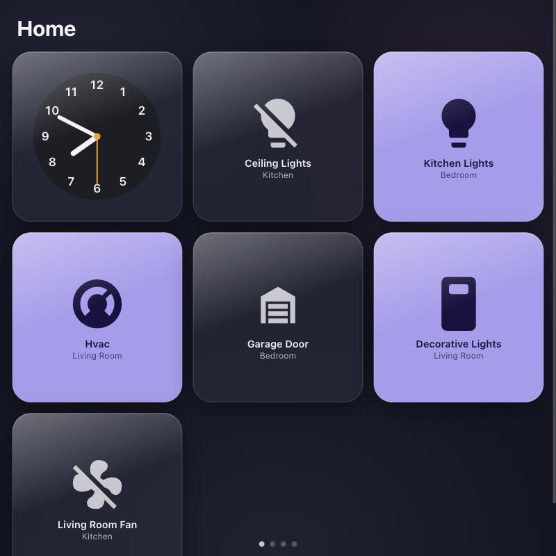
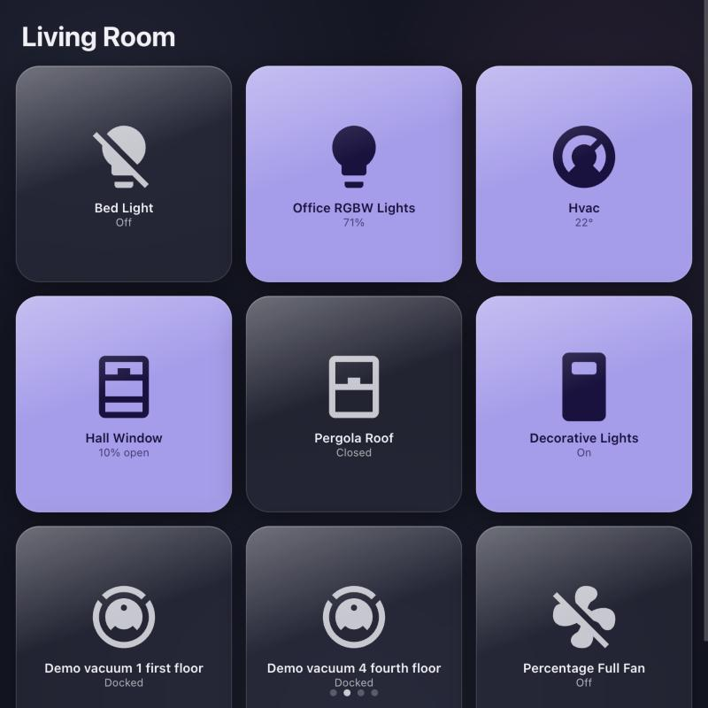
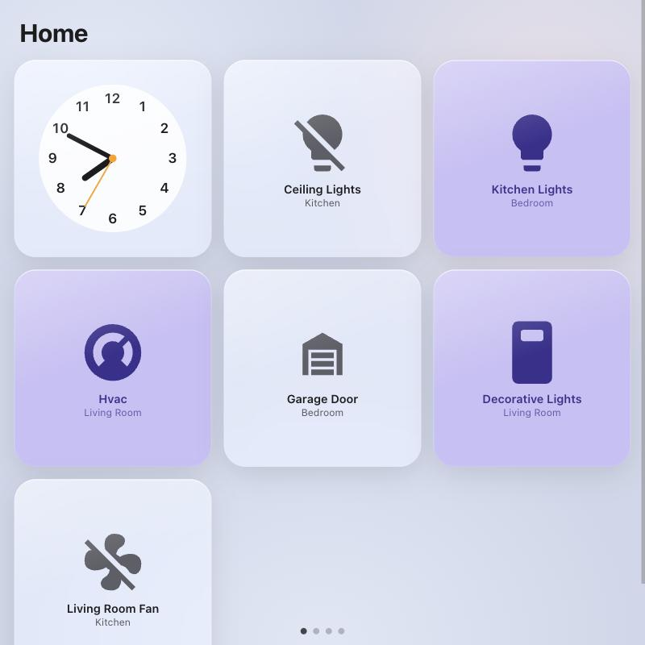

# hahomeview

An Apple HomeView-style dashboard for [Home Assistant](https://www.home-assistant.io/) that runs in Safari on old
iPads and iPhones (iOS 15.4+). Glass tiles, a clock, your rooms. Point an old iPad at it, add it to the home
screen, hang it on the wall.

| Home (dark) | Room page | Home (light) |
|---|---|---|
|  |  |  |

- **Zero HA configuration.** Rooms are your HA areas, tiles are your entities, icons come from your HA server.
- **Tap to control.** Lights, switches, fans, locks, covers, scenes, scripts, media players, vacuums. Sensors are read-only.
- **Favourites on the Home page.** Add an HA label named **Favorite** to any entity. Scenes fill in until you do.
- **Built for wall displays.** Reconnects after the iPad sleeps, no service worker, no bundled fonts or icons (48 KB of JS).
- **One container.** nginx serves the app and reverse-proxies HA, so the browser only ever talks to one origin.
  HA needs no `trusted_proxies`, CORS or `http:` changes.

## Quickstart

You need Docker on the machine that runs (or can reach) Home Assistant, and HA 2024.4 or newer.

1. Clone and start it, pointing `HA_URL` at your HA instance **by IP** (or a name the container can resolve;
   `homeassistant.local` mDNS names do not resolve inside Docker):

   ```sh
   git clone https://github.com/ThisIsJeron/hahomeview.git
   cd hahomeview
   HA_URL=http://192.168.1.10:8123 docker compose up -d --build
   ```

   Or without the repo, with your own compose file:

   ```yaml
   services:
     hahomeview:
       build: https://github.com/ThisIsJeron/hahomeview.git
       ports: ["8099:80"]
       environment:
         HA_URL: http://192.168.1.10:8123
       restart: unless-stopped
   ```

2. On the iPad, open `http://<server-ip>:8099` in Safari. Use the server's LAN IP or hostname, not a public IP
   (HA refuses public IPs as a login client).

3. Log in with your normal Home Assistant account. You land on the dashboard.

4. Tap Share → **Add to Home Screen**, then open it from the home screen and log in once more. The home-screen app
   has its own storage, so this login sticks (and Safari won't purge it after a week of no taps).

5. Optional: in HA, create a label called **Favorite** (Settings → Labels) and add it to the entities you want on
   the Home page. Set **Auto-Lock → Never** on the iPad for a wall display.

### Using an existing reverse proxy

The container listens on port 80. If you put it behind your own HTTPS proxy, keep HA and this app on the same
scheme (an `https://` app cannot open a `ws://` socket to HA), and still set `HA_URL` to where the container
reaches HA directly.

## How it works

- Vite + TypeScript + [Lit](https://lit.dev) + [`home-assistant-js-websocket`](https://github.com/home-assistant/home-assistant-js-websocket), built for Safari 15.
- Login is HA's own `/auth/authorize` page, proxied so it is same-origin. Tokens live in `localStorage`;
  the library refreshes them.
- Data comes from `subscribe_entities` plus the area, device and entity registries, refetched when HA says they changed.
- Icons: entity → `frontend/get_icons` → MDI path from HA's `/static/mdi/` chunks, cached per HA version.
- "Liquid glass" is `-webkit-backdrop-filter` blur + translucent fill + inset highlight. Safari cannot apply SVG
  filters to backdrops, so that is as far as a web page can go. The font is `system-ui`, which is San Francisco on iOS.
  Apple's SF fonts and symbols are not bundled (their licence forbids it).

## Develop

```sh
pnpm install
HA_URL=http://your-ha:8123 pnpm dev        # dev server proxies HA the same way the container does
pnpm test                                 # node --test
pnpm build && HA_URL=http://your-ha:8123 pnpm preview   # production build; use this for iOS testing
```

No HA to hand? `dev/demo-ha.sh` starts a throwaway HA with the demo integration in Docker, and
`node dev/seed.mjs` onboards it and spreads the demo entities across areas (credentials are written to
`dev/.ha-demo.env`). Then run the app with `HA_URL=http://host.docker.internal:8123`.

## Not yet

Entity detail sheets (brightness, colour, thermostat), floors as sections, a glass-styled login screen, camera
tiles beyond snapshots, HA add-on packaging. Lovelace dashboards are deliberately not rendered; rooms come from
areas.

## License

MIT
